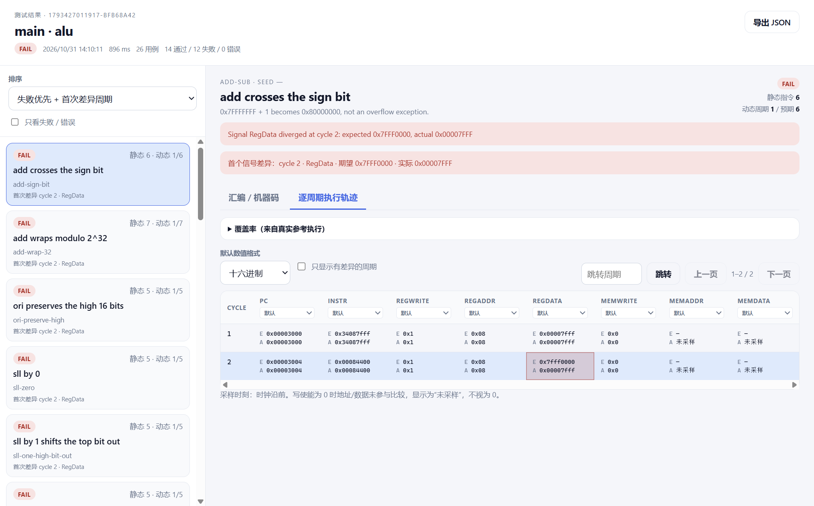
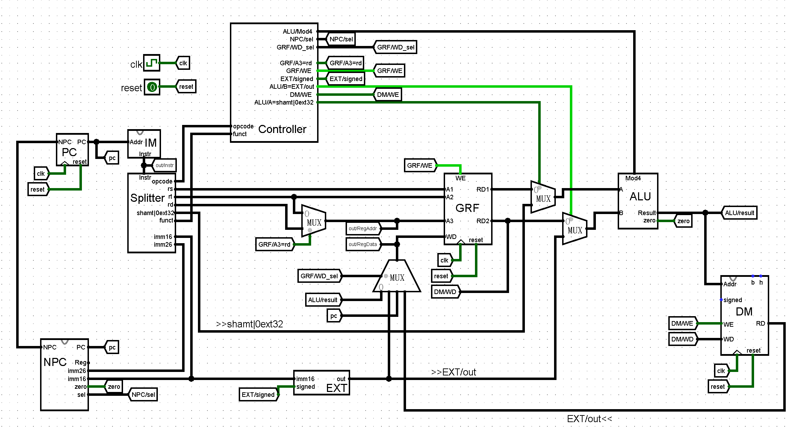
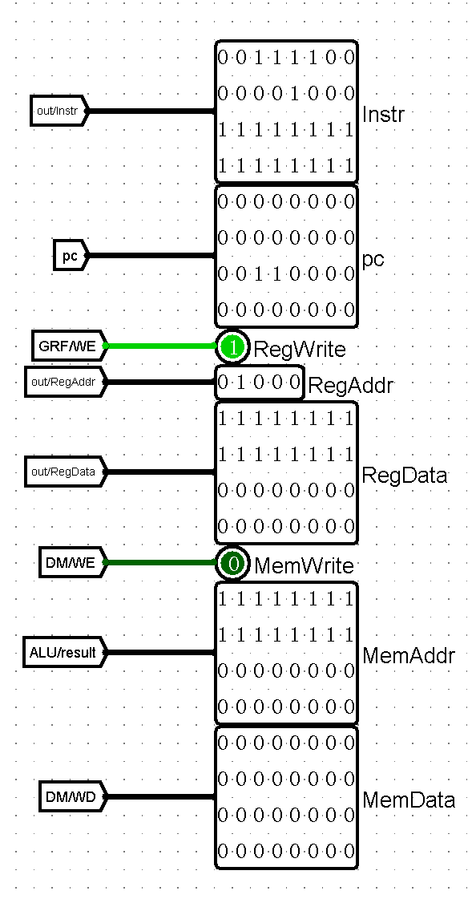
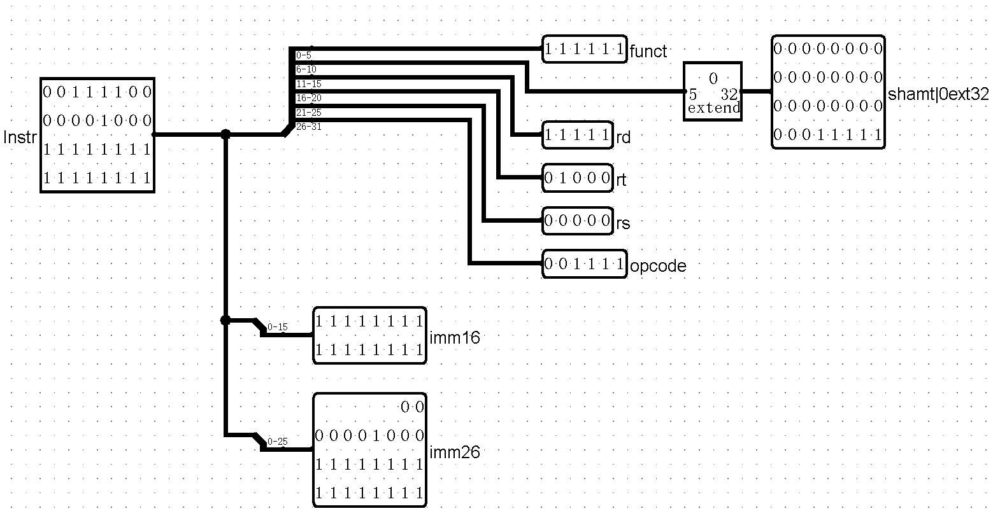
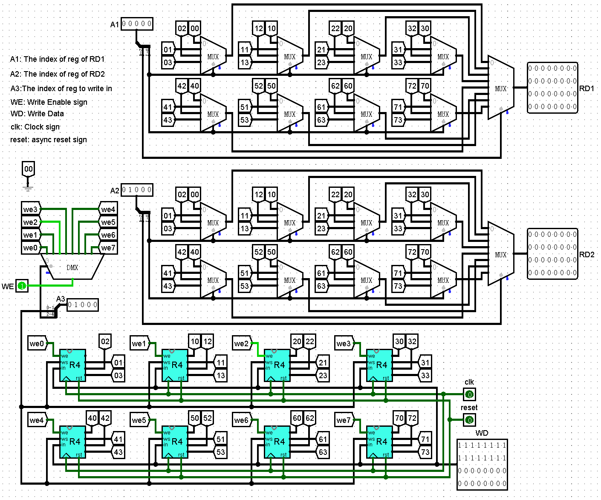
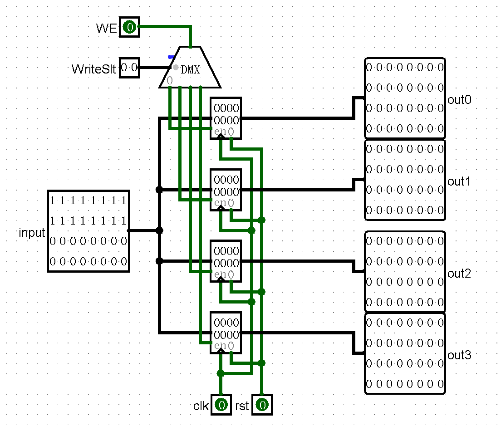
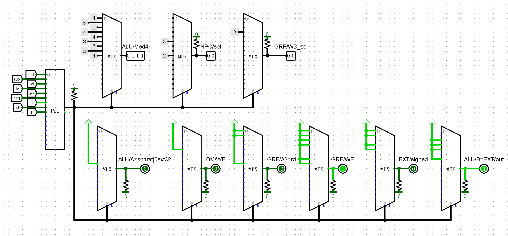
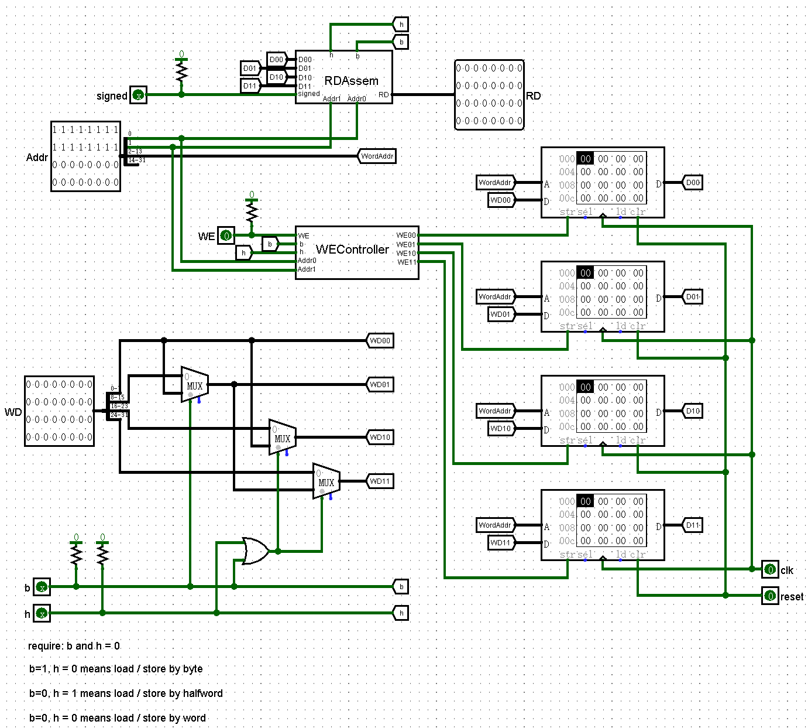
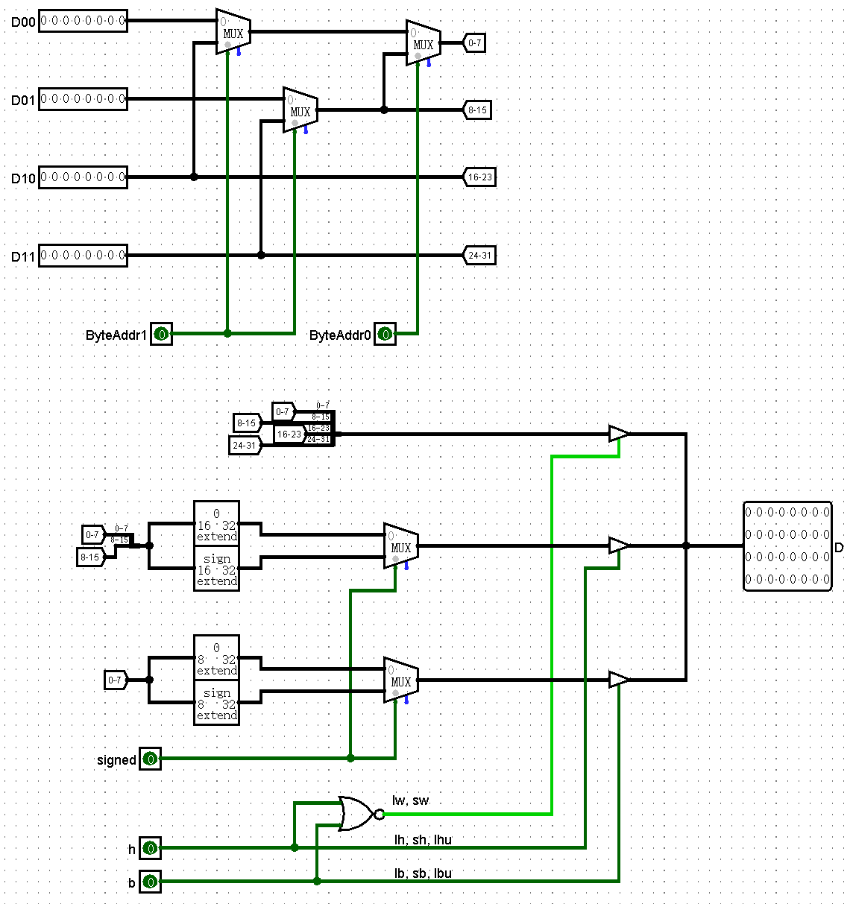
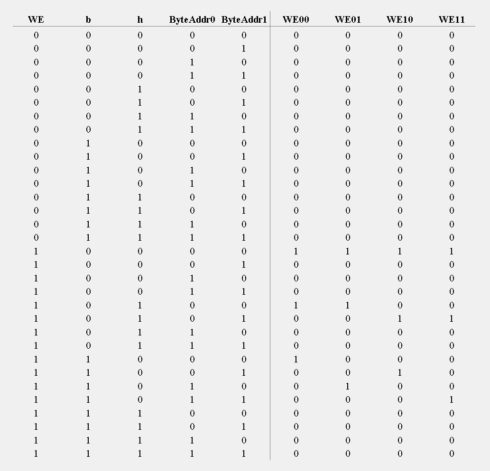

## Logisim-CPU-Autotester！

（先打个广告）这是我用大肥鱼 vibecoding 的 logisim cpu 测试小工具，专门面向 BUAA 计组 P3 课下的作业 OvO

https://github.com/PresKirimaSyaro/logisim-cpu-autotester

内置了 150+ 个汇编语言测试用例，覆盖 10 条指令，还支持随机生成指令测试，一键导出测试用例机器码。快来测测吧~


失败的测试用例可以看到首个差异的周期，以及预期的数值~



## 顶层模块

支持的指令集：`add、sub、ori、lw、sw、beq、lui、sll、j`

`add、sub` 按无符号数运算，不包含异常。

### 主体部分：


### 输出部分：


| 端口 | 方向 | 位宽 | 简要含义 |
| --- | --- | --- | --- |
| reset | 输入 | 1 | 复位 PC、GRF、DM |
| Instr | 输出 | 32 | 当前指令 |
| pc | 输出 | 32 | 当前指令地址 |
| RegWrite | 输出 | 1 | GRF 写使能 |
| RegAddr | 输出 | 5 | 写回寄存器编号 |
| RegData | 输出 | 32 | 寄存器写回数据 |
| MemWrite | 输出 | 1 | DM 写使能 |
| MemAddr | 输出 | 32 | 访存字节地址，即 ALU 结果 |
| MemData | 输出 | 32 | 存储器写入数据，来自 GRF/RD2 |

主体设计参考了 [Kamonto 大人的博客](https://kamonto.github.io/Kamonto_blog/2025/10/14/%E4%B8%80%E6%9C%AC%E4%B9%A6%E6%95%99%E4%BD%A0%E9%80%9A%E5%85%B3%E8%AE%A1%E7%BB%84%E5%AE%9E%E9%AA%8C%EF%BC%88%E4%B8%8B%EF%BC%89/)，这里主要记录一下设计不一样的地方

## Splitter



这一模块负责将从 IM 中取出的 32 位指令拆开，提供后续可以直接使用的 opcode, rs, rt, rd, funct, imm16, imm26, shamt 等段。

shamt 段用零拓展拓展至 32 位后输出，更加方便一些...

| 端口 | 方向 | 位宽 | 简要含义 |
| --- | --- | --- | --- |
| Instr | 输入 | 32 | 待拆分指令 |
| opcode | 输出 | 6 | 操作码，Instr[31:26] |
| funct | 输出 | 6 | 功能码，Instr[5:0] |
| rs、rt、rd | 输出 | 5 | 寄存器编号，分别为 [25:21]、[20:16]、[15:11] |
| shamt\|0ext32 | 输出 | 32 | Instr[10:6] 零扩展后的移位量 |
| imm16 | 输出 | 16 | 立即数，Instr[15:0] |
| imm26 | 输出 | 26 | 跳转目标字段，Instr[25:0] |

## GRF



| 模块 | 端口 | 方向 | 位宽 | 简要含义 |
| --- | --- | --- | --- | --- |
| GRF | A1、A2 | 输入 | 5 | 两个读寄存器编号 |
| GRF | A3 | 输入 | 5 | 写寄存器编号 |
| GRF | WD | 输入 | 32 | 写数据 |
| GRF | WE | 输入 | 1 | 写使能 |
| GRF | clk、reset | 输入 | 1 | 时钟、异步清零 |
| GRF | RD1、RD2 | 输出 | 32 | 两个读端口数据 |

每 4 个寄存器打包成了一个 R4：



| 模块 | 端口 | 方向 | 位宽 | 简要含义 |
| --- | --- | --- | --- | --- |
| GRF_R4 | input | 输入 | 32 | 组内公共写入数据 |
| GRF_R4 | WriteSlt | 输入 | 2 | 组内写寄存器编号 |
| GRF_R4 | WE | 输入 | 1 | 本组写使能 |
| GRF_R4 | clk、rst | 输入 | 1 | 时钟、异步清零 |
| GRF_R4 | out0～out3 | 输出 | 32 | 四个寄存器的当前值 |

这样的设计能让你在手搭 GRF 的时候减小一点点工作量，但是会增大一定的复杂度。如果课上涉及特殊的某个寄存器的操作也可以选择定制一个特殊的 R4 来替换原有的 R4。

## Controller

Controller 的控制信号部分：



像弹簧一样的元件是下拉电阻，把它接到一段导线上，**可以让这段导线在原本为 `x` 的时候变成 `0`**，很方便。

所以这样在 MUX 中可以不写 `0` 的地方。这时可以将所有默认控制信号的值设成 `0`，可以减小 Controller 的复杂度。

### 血的教训

**这里请不要试图用 ROM 代替 MUX 打表！！！**

因为评测机要求你的电路文件中有且只有一个 ROM，位于 IM 中，会向你的这个 ROM 中导入机器码。这里使用 ROM 上传之后，值会被修改。所以还是用 MUX 吧。

## DM



| 模块 | 端口 | 方向 | 位宽 | 简要含义 |
| --- | --- | --- | --- | --- |
| DM | Addr | 输入 | 32 | 访存字节地址 |
| DM | WD | 输入 | 32 | 写入数据；sb、sh 分别取低 8、16 位 |
| DM | WE | 输入 | 1 | 总写使能 |
| DM | b、h | 输入 | 1 | 字节、半字访问选择，二者不可同时为 1 |
| DM | signed | 输入 | 1 | 字节、半字读取时是否符号扩展 |
| DM | clk、reset | 输入 | 1 | 写入时钟、异步清零 |
| DM | RD | 输出 | 32 | 读取并完成拼接、扩展的数据 |

这个元件考虑了对 `lb, lbu, sb, lh, lhu, sh` 这类指令的支持。

由于 Logisim 的 RAM 必须提前设置好单次读取 / 修改的位宽，所以改成 32 之后`sb, sh` 就很难实现了。

这里采取使用 4 个 RAM，分别模拟连续内存字节编码末两位为 `00`, `01`, `10`, `11` 的部分。

执行 `sw` 会同时写入四个 RAM，执行 `sh` 则只会写入前两个或后两个，执行 `sb` 则只会写入四个中的一个。

`b`, `h` 均为 0 时为按整字读写；`b = 0, h = 1` 则为按半字操作；`b = 1, h = 0` 为按字节操作。

### DM_RDAssem:



| 模块 | 端口 | 方向 | 位宽 | 简要含义 |
| --- | --- | --- | --- | --- |
| DM_RDAssem | D00、D01、D10、D11 | 输入 | 8 | 偏移 0、1、2、3 对应 RAM 的读数据 |
| DM_RDAssem | ByteAddr0、ByteAddr1 | 输入 | 1 | 字内字节、半字选择地址 |
| DM_RDAssem | b、h | 输入 | 1 | 读数据宽度选择 |
| DM_RDAssem | signed | 输入 | 1 | 0：零扩展；1：符号扩展 |
| DM_RDAssem | D | 输出 | 32 | 拼接、扩展后的读数据 |

这个模块主要负责将四个 RAM 的读取结果拼成整体的结果。用 Verilog 表达的逻辑是：

```verilog
module DM_RDAssem (
    input  [7:0] D00, D01, D10, D11,    // 从四个 RAM 中读取到的数据
    input  [1:0] ByteAddr,              // DM 输入 Address 的后两位，读取半字和字节的时候需要用
    input        b, h, my_signed,       // 读取模式，由于 signed 是 verilog 关键字所以换成了 my_signed    
    output [31:0] RD                    // 拼装好的读取数据
);
    // 如果是按整字读取的话，那么按 word_data 这样按字节拼好
    wire [31:0] word_data = {D11, D10, D01, D00};

    // 如果按字节读取，那么根据 ByteAddr 的两位在四个 RAM 中选择一个
    wire [7:0] byte_data = (
        ByteAddr[1] ?   
        (ByteAddr[0] ? D11 : D10) :
        (ByteAddr[0] ? D01 : D00)
    );

    // 如果按照半字读取，那么在 {D11, D10} 和 {D01, D00} 中选择
    wire [15:0] half_data = ByteAddr[1] ? {D11, D10} : {D01, D00};

    // 选择输出，下面的写法有些猎奇，这都是 Verilog 的错，实际上这是两层三目运算符的嵌套
    assign RD = (
        b ? (
            my_signed ? {{24{byte_data[7]}}, byte_data} : {24'b0, byte_data}
        ) :
        h ? (
            my_signed ? {{16{half_data[15]}}, half_data} : {16'b0, half_data}
        ) :
        word_data
    );
endmodule
```

### DM_WEController:

这个元件用来控制每个 RAM 的 WE，就是纯组合逻辑

| 模块 | 端口 | 方向 | 位宽 | 简要含义 |
| --- | --- | --- | --- | --- |
| DM_WEController | WE | 输入 | 1 | 总写使能 |
| DM_WEController | b、h | 输入 | 1 | 访问宽度选择 |
| DM_WEController | ByteAddr0、ByteAddr1 | 输入 | 1 | 字节地址低两位，分别对应 Addr[0]、Addr[1] |
| DM_WEController | WE00、WE01、WE10、WE11 | 输出 | 1 | 偏移 0、1、2、3 对应 RAM 的写使能 |

如果用 Verilog 表达的话：

```Verilog
module DM_WEController (
    input WE, b, h,
    input [1:0] ByteAddr,
    output reg WE00, WE01, WE10, WE11
);
    always @(*) begin
        {WE11, WE10, WE01, WE00} = 4'b0000;
        if (WE) begin
            if (b && !h) begin
                case (ByteAddr)
                    2'b00: WE00 = 1;
                    2'b01: WE01 = 1;
                    2'b10: WE10 = 1;
                    2'b11: WE11 = 1;
                endcase
            end
            else if (h && !b && !ByteAddr[0]) begin
                if (ByteAddr[1] == 0)
                    {WE01, WE00} = 2'b11;
                else
                    {WE11, WE10} = 2'b11;
            end
            else if (!b && !h && ByteAddr == 2'b00) begin
                {WE11, WE10, WE01, WE00} = 4'b1111;
            end
        end
    end
endmodule
```

直接给真值表了：

