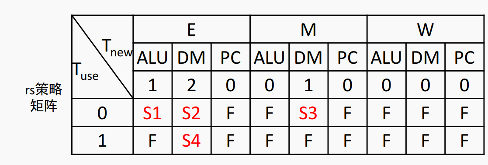

## 课上分析阻塞转发方法的弊端

计组课上分析阻塞与转发的通常思维方式是考虑两条执行顺序分前后的指令对，
根据数据提供者和需求者的关系建立 E->D, M->D, W->D, M->E, W->E, W->M 六种转发关系以及阻塞矩阵



这种分析方式有它的优点，但是在从零开始架构流水线的时候很容易无从下手。
根本原因是原先我们对 cpu 的认识都是**对于特定的一条指令**，思考它是如何处理的，包括数据流、控制流等等。
但是这种流水线分析的方法需要我们去分析一前一后的两条指令的依赖关系，需要处理的情况大幅度增加。

于是，这里给出一种新的思考方式，在建模时只关注在 D 级的指令，将前序指令的执行情况看作是流水级的“环境”。
这样可以将指令之间的关系解耦，无论是在编写 cpu 时还是在添加新指令时，只需要考虑新增指令本身的行为即可。

## Data Promise

流水线采取阻塞和转发，根本上是为了正确处理指令并行执行时所产生的数据依赖关系。
那么如何描述一条指令对数据的需求和供给行为呢？

这里采取与课上相似的模型，不过符号上稍作修改：

一些基础的符号：
+ 我们对四个流水级进行编号：$\{D:0, E:1, M:2, W:3\}$
+ $rs(I), rt(I)$ ：指令 $I$ 的 rs, rt 对应寄存器编号（如果有的话）
+ $R(I)$：$I$ 指令读取的寄存器编号集合（除了 0 号寄存器）

### 数据的产生

在初级的模型中，我们假设一条指令最终只会写入最多一个寄存器，
且如果写入，那么目标寄存器的编号在进入 IF/ID 时就已经确定了。

对于位于流水线某一级的指令 $I$，其产生数据的行为可以由下面三个量描述：
+ $target$：指令 $I$ 写入的目标寄存器编号
+ $val$：指令 $I$ 写入寄存器的值
+ $lag$：从指令 $I$ 再经过几个上升沿才能**将数据写入某一级流水寄存器**

我们将对应的这三个量视作一个“协议”，或者视作一种“数据承诺”（promise）。
指令之间的数据依赖只需要通过这个标记就可以进行信息传递。

例如下面的程序，将第一行的 `or` 指令换成注释中的 `add`，
对于在 ID/EX 级的 `sub` 指令，其转发的行为完全相同。
```assembly
# $t0 = 3, $t1 = 5, $t2 = 4
or $s0, $t0, $t1    # add $s0, $t0, $t2
sub $s0, $s0, $t0
```

在指令 `sub` 进入 IF/ID 时，无论此时在 ID/EX 级的指令是 `or` 还是 `add`，
它们的给出的承诺都是：
+ $lag$ = 1
+ $target$ = 16(`$s0`)
+ $val$ 还没有就绪
也就是：**承诺最晚再过 1 个上升沿就可以产生要写入 t0 的数据**

在一个上升沿之后，`sub` 进入 ID/EX，无论此时在 EX/MEM 级的指令是 `or` 还是 `add`，
其数据承诺都为：
+ $lag$ = 0（即已就绪）
+ $target$ = 16
+ $val$ = 32'b7

我们可以让每一条指令在随着流水线推进时维护这三个量，
这样 `sub` 指令在 `E` 级时完全可以忽视之前是什么指令，只查看后续流水级的 promise 来接收 `$s0` 的值，完成转发。

### 数据的需求

记 $R(I)$ 为指令 $I$ 读取的寄存器编号集合，一个指令数据的需求可以用下面的函数描述：
$$
    t_I: R(I) \to \{0, 1, 2, 3\}
$$

其中，$t_I(r)$ 表示指令 $I$ 在 IF/ID 时，**再经过几个上升沿就必须使用**寄存器 $r$ 的值。

例如对于 $I$ = `add $9, $8, $9` 来说，$t_I(8) = t_I(9) = 1$，因为再过一个上升沿 $I$ 进入 ID/EX，
此时必须使用 `$8` 和 `$9` 的值。

对于 $I$ = `sw $8, 0($9)` 来说，`$8` 直到 M 级访存才会使用，而 `$9` 在 E 级必须参与 ALU 运算，
因此 $t_I(8) = 2, t_I(9) = 1$。

而对于 $I$ = `beq $8, $9, ...` 来说，由于我们将跳转比较提前到 D 级执行，所以 $t_I(8) = t_I(9) = 0$

综合上面的建模，我们可以列出下面的表格：

|  $I$      | add  | sub  | ori  | lw   | sw   | beq  | lui  | jr   | jal  | sll  | or   | addi | bne  | j    | jalr |
| --------- | ---- | ---- | ---- | ---- | ---- | ---- | ---- | ---- | ---- | ---- | ---- | ---- | ---- | ---- | ---- |
| $t_I(rs(I))$     | 1    | 1    | 1    | 1    | 1    | 0    | x    | 0    | x    | x    | 1    | 1    | 0    | x    | 0    |
| $t_I(rt(I))$     | 1    | 1    | x    | x    | 2    | 0    | x    | x    | x    | 1    | 1    | x    | 0    | x    | x    |
| 初始 $lag$（位于 IF/ID）       | 2    | 2    | 2    | 3    | x    | x    | 2    | x    | 1    | 2    | 2    | 2    | x    | x    | 1    |
| $val$ 的来源 | AO   | AO   | AO   | DR   | x    | x    | AO   | x    | pc8  | AO   | AO   | AO   | x    | x    | pc8  |
| $target$    | rd   | rd   | rt   | rt   | x    | x    | rt   | x    | 31   | rd   | rd   | rt   | x    | x    | rd   |

### 阻塞与转发

在写 P5 时，我推荐这样思考阻塞与转发逻辑：
1. 先不考虑阻塞，设计转发的通路及逻辑
2. 再考虑阻塞的条件以及设计

#### 转发

来看下面的这段代码：
```assembly
ori $8, $0, 1   # I2
ori $9, $0, 2   # I1
add $16, $8, $9 # I
nop
```

指令 $I$（`add`）依赖于前面的 $I_1$，$I_2$ 的数据。

$t_I(8) = t_I(9) = 1$，在 $I$ 进入 E 级后就必须使用这两个寄存器的值

|   流水级   | IF/ID | ID/EX | EX/MEM | MEM/WB |
| :--------: | :---: | :---: | :----: | :----: |
| 流水级编号 |   0   |   1   |   2    |   3    |
|    指令    |  nop  | $I$(add)   | $I_1$(ori)  | $I_2$(ori)  |
| lag       |   -   | 1         | 0  | 0  |
| target    |   -   | 16        | 9  | 8  |
| val       |   -   | 还没产生  | 2  | 1  |

此时，位于 ID/EX 的 $I$ 可以扫描位于 EX/MEM 和 MEM/WB 指令的 promise。如果某条 promise 的 target 刚好等于自己的 rs 或者 rt，且 lag 等于 0，这时就可以用这个 promise 的 val 来更新 $I$ 自己原本要使用的 `RD1@E` 和 `RD2@E`。

扫描时的顺序应该是从后向前，也就是按流水级编号从大到小。因为越靠前的指令越先执行。越优先转发。

#### 阻塞

现在我们来想，什么时候我们无法转发呢？

对于上面的情况，当 $I$ 进入 ID/EX，需要使用寄存器的值时，
如果位于 EX/MEM 或者 MEM/WB 的指令还没有准备好数据（也就是 $lag\neq 0$），这时就不能转发了。

对于每条指令来说，$lag$ 每过一级至少减少 $1$。

当指令 $I$ 位于 IF/ID 时，我们需要判断位于 ID/EX，EX/MEM，MEM/WB 的三条 promise，它们还需要各自 $lag$ 个上升沿后才能转发。

假如 $I$ 在 $t_I(rs(I)) = 1$ 个上升沿后就需要使用 $rs(I)$ 的值。但是它依赖的后面某一级的 promise 的 $lag=2$。这时我们就必须要阻塞了。

我们对其进行形式化：

|   流水级   | IF/ID | ID/EX | EX/MEM | MEM/WB |
| :--------: | :---: | :---: | :----: | :----: |
| 流水级编号 |   0   |   1   |   2    |   3    |
|    指令    |  $I$  | $I_1$ | $I_2$  | $I_3$  |

令 $promise_k$ 表示此时第 $k$ 级流水级中存放的数据 $promise$（由 $I_k$ 在 IF/ID 时发放）

用 $lag(p), target(p)$ 分别表示 promise $p$ 的延迟和目标寄存器编号

记 $depend_r(I,k)$ 表示指令 $I$ 是否与 $I_k$ 在寄存器 $r$ 的数据上存在依赖，那么：
$$
depend_r(I,k) = [\bigwedge_{i=1}^{k-1}target(promise_i)\neq r]\land[target(promise_k)=r\neq0]
$$

记 $Stall_k$ 表示此时是否需要阻塞等待指令 $I_k$，那么：
$$
Stall_k = \bigvee_{r\in R(I)}[depend_r(I,k)\land lag(promise_k) > t_I(r)]
$$

最终是否需要阻塞的信号：
$$
Stall = \bigvee_{i = 1}^3 Stall_i
$$

## Verilog 实现方法

### 对于应试的模型拓展

我们的上述 data promise 模型已经相当完美，只需要针对应试进行一些小改造。

上机考试加的指令可能会有一些超出 P5 课下指令集的行为特点，比如：
1. 根据不同的条件在不同的流水级产生值
2. 最终写入的寄存器编号不能在一开始就确定

对于第一条，我们的模型实际上已经适配了。由于 $lag$ 表示的是“最坏延迟”，我们原先的指令为逐级减一，到 0 位置。现在我们维护每级的“最坏延迟”即可。

对于第二条，我们可以将 promise 的 target 指定一个写入寄存器改为维护一个“可能写入寄存器集合”。

在这里，我们用 verilog 中的一个 69 位向量表示一个 promise，高 5 位表示 $lag$，`promise[32+:32]` 表示 $target$（$target$ 第 $i$ 位为一表示可能写入寄存器 $i$），用低 32 位表示产生的值。

接下来，我们只需考虑一条指令如何发出 promise、传递 promise、查看 promise 进行阻塞和转发的逻辑即可。

### promise 的发射

当指令在 IF/ID 时，我们将指令进行译码后填入相应的 $target$ 和 $lag$ 即可。

```verilog
// issue the promise
function [`PRMS_LEN - 1:0] issue_promise(input [31:0] IR);
// promise: 
//      0... || lag(5) || target(32) || val(32)
reg [5:0] opcode, funct;
reg [4:0] rs, rt, rd, shamt;
reg [15:0] imm16;
reg [25:0] imm26;
reg ins_add, ins_sub, ins_ori, ins_lw, ins_sw;
reg ins_lui, ins_jal, ins_jr, ins_sll, ins_or;
reg ins_addi, ins_jalr, ins_sllv;
reg [4:0] lag;
reg [31:0] target;
begin
    {opcode, rs, rt, rd, shamt, funct} = IR;
    imm16 = IR[0+: 16];
    imm26 = IR[0+: 26];

    ins_add = (~|opcode) && funct == `funct_add;
    ins_sub = (~|opcode) && funct == `funct_sub;
    ins_ori = opcode == `opcode_ori;
    ins_lw	= opcode == `opcode_lw;
    ins_sw	= opcode == `opcode_sw;
    ins_lui	= opcode == `opcode_lui;
    ins_jal	= opcode == `opcode_jal;
    ins_jr	= (~|opcode) && funct == `funct_jr;
    ins_sll	= (~|opcode) && funct == `funct_sll;
    ins_or  = (~|opcode) && funct == `funct_or;
    ins_addi    = opcode == `opcode_addi;
    ins_jalr    = (~|opcode) && funct == `funct_jalr;
    ins_sllv    = (~|opcode) && funct == `funct_sllv;

    target = (
        |{ins_add, ins_sub, ins_sll, ins_or, ins_jalr, ins_sllv}    ? 
            32'b1 << rd :
        |{ins_ori, ins_lw, ins_lui, ins_addi}   ? 
            32'b1 << rt :
        |{ins_jal}  ? 
            32'b1 << 5'd31 :
        // default
            32'd0 // regard as not writing
    );
    lag = (
        |{ins_jal, ins_jalr}  ? 
            5'd1 :
        |{ins_add, ins_sub, ins_ori, ins_lui, ins_sll, ins_or, ins_addi, ins_sllv} ? 
            5'd2 :
        |{ins_lw} ?
            5'd3 :
        // default
            5'd0
    );

    issue_promise = {lag, target, 32'd0};
end
endfunction
```

在 FDreg 中，我们将 promise 塞入即可：
```verilog
FDreg FDreg(
    .F_promise(issue_promise(ins)),
    ...
);
```

### promise 的推进

我们可以在各级流水寄存器中实现这个逻辑。

如果进入某一级寄存器，该指令产生了结果，那么就将当前本级的 promise 的 lag 置零表示已就绪，val 填入相应结果，target 不变，作为下一级 promise。

否则就将 lag 减去 1。

对于 `jal`, `jalr` 等写入 `pc8` 的指令，结果在 D 级产生，在 DEreg 中：

```verilog
always @(posedge clk) begin
    if (reset | clr) begin
        // ...
        E_promise <= `PRMS_LEN'd0;
    end
    else begin
        if (en) begin
            // ...
            E_promise <= (
                |{ins_jal, ins_jalr} ? 
                    {5'd0, target32, D_pc8} :
                    {|lag5 ? lag5-5'd1: lag5, target32, val32}
            );
        end
    end
end
```

对于写入 ALU 运算结果的指令，值在 E 阶段产生，在 EMreg 中：
```verilog
always @(posedge clk) begin
    if (reset | clr) begin
        // ...
        M_promise <= `PRMS_LEN'd0;
    end
    else begin
        if (en) begin
            // ...
            M_promise <= (
                |{ins_add, ins_sub, ins_ori, ins_lui, ins_sll, ins_or, ins_addi, ins_sllv} ?
                    {5'd0, target32, E_AO} :
                    {|lag5 ? lag5-5'd1 : lag5, target32, val32}                
            );
        end
    end
end
```

对于访存类指令 `lw`，值在 M 级产生，在 MWreg 中：
```verilog
always @(posedge clk) begin
    if (reset | clr) begin
        // ...
        W_promise <= `PRMS_LEN'd0;
    end
    else begin
        if (en) begin
            // ...
            W_promise <= (
                |{ins_lw} ? 
                    {5'd0, target32, M_DR} :
                    {|lag5 ? lag5-5'd1: lag5, target32, val32}
            );
        end
    end
end
```

最终，当 promise 传递到 W 级后，将携带的写入信息直接写入寄存器堆中即可。

写入寄存器编号应当将 promise 的 target 段中 1 的位置解码出来。等价于取以二为低的对数。

```verilog
function [4:0] get_bit(input [31:0] x);
integer i;
reg [4:0] res;
begin
    res = 5'd0;
    for (i = 1; i < 32; i = i + 1)
        if (x[i]) res = i[0+:5];
    get_bit = res;
end
endfunction

RF RF(
    .clk(clk), .reset(reset),
    .A1(D_rs), .A2(D_rt), 
    .RD1(RF_RD1), .RD2(RF_RD2),
    // from W:
        .WE(|W_promise[32+:32]),
        .this_PC(W_pc8 - 32'd8), 
        .A3(get_bit(W_promise[32+:32])),
        .WD(W_promise[0+:32])
);
```

### promise 用于转发和阻塞

处理转发时，我们只需要在各级需要 RD1 和 RD2 时，无脑用后续流水级的 promise 更新即可。

以 D 级为例：

```verilog
function [36:0] update(input [36:0] origin, input [`PRMS_LEN - 1:0] promise);
reg [4:0] obj, lag;
reg [31:0] target, val;
begin
    {lag, target, val} = promise[0+:69];
    // target == 32'd0 : promise no writing
    obj = origin[0+:5];
    update = (
        lag == 5'd0                 // data promise is ready
        && obj != 5'd0           // promise is valid
        && target[obj] ?
            {val, obj} : origin
    );
end
endfunction

assign fwD_RD1 = 
    update(update(update({RF_RD1, D_rs}, W_promise), M_promise), E_promise) >> 5;
assign fwD_RD2 = 
    update(update(update({RF_RD2, D_rt}, W_promise), M_promise), E_promise) >> 5;
```

实现阻塞时，我们翻译形式化公式即可：

```verilog
function check(input [4:0] r, input [4:0] t, input [3*`PRMS_LEN - 1:0] promises);
reg d1, d2, d3;
reg [4:0] lag1, lag2, lag3;
reg [31:0] tar1, tar2, tar3;
reg [`PRMS_LEN - 1:0] ep, mp, wp;
begin
    {ep, mp, wp} = promises;
    {lag1, tar1} = ep[32+:37];
    {lag2, tar2} = mp[32+:37];
    {lag3, tar3} = wp[32+:37];

    d1 = r != 0 && tar1[r];
    d2 = r != 0 && tar2[r] && &{~tar1[r]};
    d3 = r != 0 && tar3[r] && &{~tar1[r], ~tar2[r]};
    
    check = |{
        d1 && lag1 > t,
        d2 && lag2 > t,
        d3 && lag3 > t
    };
end
endfunction

assign promises = {E_promise, M_promise, W_promise};

assign stall = (
    ins_add     ? check(rs, 1, promises) | check(rt, 1, promises) :
    ins_sub     ? check(rs, 1, promises) | check(rt, 1, promises) :
    ins_ori     ? check(rs, 1, promises) :
    ins_lw      ? check(rs, 1, promises) :
    ins_sw      ? check(rs, 1, promises) | check(rt, 2, promises) :
    ins_beq     ? check(rs, 0, promises) | check(rt, 0, promises) :
    ins_jr      ? check(rs, 0, promises) :
    ins_sll     ? check(rt, 1, promises) :
    ins_or      ? check(rs, 1, promises) | check(rt, 1, promises) :
    ins_addi    ? check(rs, 1, promises) :
    ins_bne     ? check(rs, 0, promises) | check(rt, 0, promises) :
    ins_jalr    ? check(rs, 0, promises) :
    ins_sllv    ? check(rs, 1, promises) | check(rt, 1, promises) :
    0
);

endmodule
```

我将完整的 P5 代码上传到了 [github仓库](https://github.com/PresKirimaSyaro/buaa-co-p5) 上（学期结束后会公开）。快来看看吧~