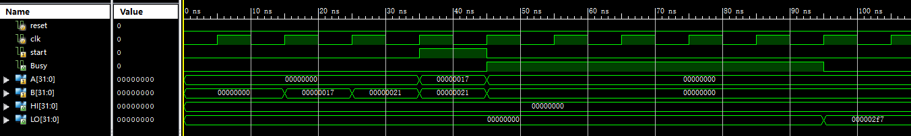
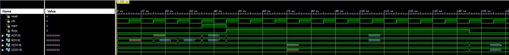
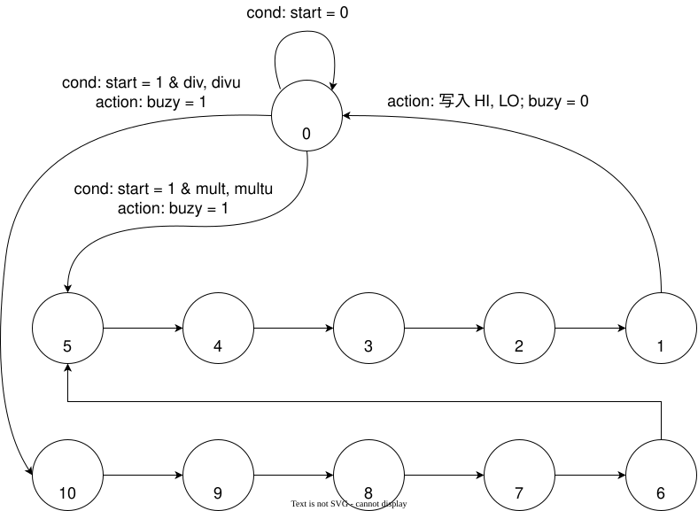
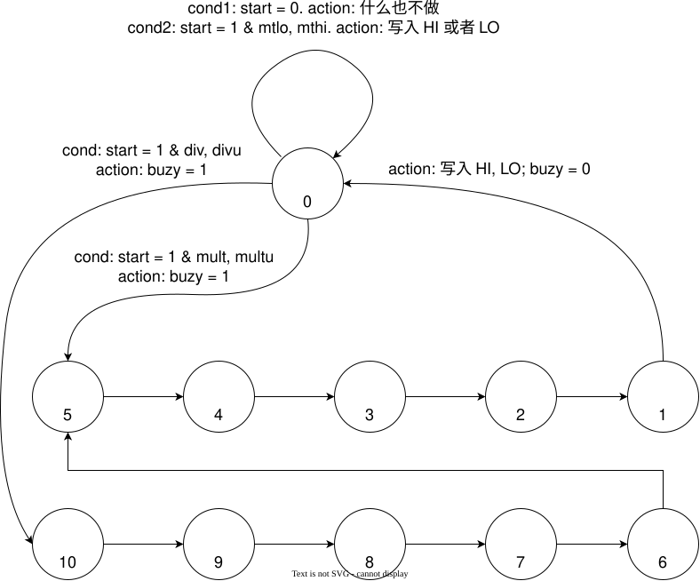

P6 课下要求将支持的指令条数增加到 30 条，包括下面这些：

```
add, sub, and, or, slt, sltu, lui
addi, andi, ori
lb, lh, lw, sb, sh, sw
mult, multu, div, divu, mfhi, mflo, mthi, mtlo
beq, bne, jal, jr
```

和 P5 课下 10 条指令的流水线 cpu 相比，除了指令增多，主要的要求在于：
+ 要求支持乘除法指令，乘除运算要模拟 cpu 中的乘除法指令延迟。
  乘法需要 5 个周期才能出结果，除法则需要 10 个周期，相应的阻塞和转发的逻辑也需要配合。
+ 需要将 IM 和 DM 分离到 cpu 之外，在 tb 中实现（这部分 tb 会直接提供，不需要自己实现）。
+ 要求支持 `lb, lh, sb, sh` 这些非整字访存的指令（这部分的核心逻辑在提供的 tb 中实现了，只要连好接口信号就好了）。

## 指令分类

P6 要求支持的指令非常多，降低复杂度的一大方式就是将在一些层次行为相同的指令合并为一类。

每两条指令的行为肯定都是不一样的，指令分类的思维方式是求同存异，
例如我们可以将在阻塞和转发上行为一致的指令归为一类。我这里主要建立了 5 个指令类：

| 名称 | 包含指令  | $t_I(rs(I))$  | $t_I(rt(I))$  | 初始 $lag$    | 写入寄存器 | 写入数据来源  |
| :---:     |   :---:       | :---:         | :---:         | :---:         | -----         | -----         |
|rcal|add, sub, or, and, sllv, slt, sltu|$1$|$1$|$2$|$rd(I)$|`ALU/AO`|
|ical|ori, addi, andi|$1$|-|$2$|$rt(I)$|`ALU/AO`|
|load|lb, lbu, lh, lhu, lw|$1$|-|$3$|$rt(I)$|`DM/RD`  经过拓展等处理的输出|
|save|sb, sh, sw|1|2|-|-|-|
|mudv|mult, multu, div, divu|1|1|-|$HI, LO$|乘除法单元内部计算结果|

还有几个没有分类的指令：`beq, bne, lui, sll, j, jr, jal, jalr, mflo, mfhi, mtlo, mthi`

这里建议按照读写数据（包括阻塞和转发）方面的行为进行分类，而不是按照指令的 R型、I型等。

在写控制信号的时候，我们就可以直接用指令类了：
```verilog
// 译码时：

assign ins_add  = (~|opcode) && (funct == `funct_add);
assign ins_sub  = (~|opcode) && (funct == `funct_sub); 
assign ins_or   = (~|opcode) && (funct == `funct_or);  
assign ins_and  = (~|opcode) && (funct == `funct_and); 
assign ins_sllv = (~|opcode) && (funct == `funct_sllv);
assign ins_slt  = (~|opcode) && (funct == `funct_slt); 
assign ins_sltu = (~|opcode) && (funct == `funct_sltu);
assign cla_rcal = |{ins_add, ins_sub, ins_or, ins_and, ins_sllv, ins_slt, ins_sltu};

assign ins_addi = opcode == `opcode_addi;
assign ins_ori  = opcode == `opcode_ori; 
assign ins_andi = opcode == `opcode_andi;
assign cla_ical = |{ins_ori, ins_addi, ins_andi};

// =========================

assign MALUA = (
    ins_sll ? 1 :   // use zero_ext32(shamt)
    0   // use RD1
);
assign MALUB = (
    |{cla_load, cla_save, cla_ical, ins_lui} ? 1 :   // use ext32(imm16)
    0   // use RD2
);
```

## 乘除法模块

P6 要求支持乘除法功能，不用从门级实现乘除法电路，但是要模拟相应的延迟。

实验指导书上提供的乘除法功能的仿真信号图像：





乘除法模块要求用 `start` 信号启动运算，运算乘法需要 5 个周期，除法需要 10 个周期。正在运算时用 `buzy` 信号标记乘除法模块正忙。

显然这是一个时序逻辑模块，如果数不清周期容易出现加一减一的问题。
因为这种模块所有的动作都是在上升沿完成的，我比较惯用的方法是数上升沿。例如对于乘法指令来说：

+ 如果某一个上升沿，`start` 信号为 1，那么启动计算，将 `buzy` 置 1，这时可以看成第0 个上升沿
+ 第 1 个上升沿到第 4 个上升沿什么也不做（因为我们只是在模拟）
+ 第 5 个上升沿，计算结束，写入数据并将 `buzy` 置 0

除法也是同理。将这个逻辑画成状态机就是下面这样：



## 乘除法指令的阻塞和转发

指导书要求在乘除法模块在处理时（`start` 为 1 或者 `buzy` 为 1），乘除法相关指令全部阻塞在 D 级。这种约束降低了问题的复杂性。

除此之外，我们还需要处理 `mflo`，`mfhi`，`mtlo`，`mthi` 这几条指令。

我的实现方式是将 `HI`, `LO` 寄存器放在 E 级，对于 `mflo`, `mfhi`，我们认为它们初始 $lag = 2$。
这样设计可以尽可能融入之前的框架，例如对于：

```assembly
mflo    $t8
beq     $t8, $t9, target
```
这样 beq 就会阻塞一周期。

至于它们的阻塞条件，由于这两条指令不使用任何一般寄存器的值，所以它们只需要在 $start \lor buzy = 1$ 时阻塞就可以了。

对于 `mtlo`, `mthi` ，它们需要 `rs` 的值，而且会修改 `HI` 和 `LO`。

由于我们确定了 `HI` 和 `LO` 的位置在 E 级，我们就不要想太多，将这两条指令看作在 E 级写入就好了。
因此它们的 $t(rs) = 1$。

> 对于这类没有计算仅仅是移动数据的指令，理论上它们使用数据和产出数据的时间可以随意调整，
> 只需满足：使用数据时间不在产出数据时间之后即可。
>
> 设置 $t(rs) = 1$ 的确可能导致在 `lw + mtlo/mthi` 时阻塞一周期，设置成 $t(rs) = 2$，在 M 级写入 `HI, LO` 的确可以避免阻塞，
> 但是这样会使得在 `mtlo/mthi` 后的 `mflo/mfhi` 需要等待一周期。

对于 `HI` 和 `LO`，我们可以规定对这两个寄存器的修改必须通过 MDU 来进行。
这时我们把 `mtlo`, `mthi` 看作一个需要 0 周期就可以算好且只修改一个寄存器的某种乘除法指令就可以。

## verilog 实现

### 乘除法模块

按照前文的设计，我们的乘除法模块应该长这个样子：

```verilog
module MDU (
    input           start,
    input           clk,
    input           reset,
    input [31:0]    E_IR,
    input [31:0]    A,
    input [31:0]    B,

    output reg [31:0]   LO,
    output reg [31:0]   HI,
    output              buzy
);
```

`A` 和 `B` 连接 E 级送往 ALU 的两个运算参数。只有在 `start` 等于 1 的时候，MDU 才会启动多周期运算。

我们将 `mtlo`, `mthi` 的逻辑也添加到状态机中，由于它们 0 周期就可以计算完成，所以相当于是从 0 到 0 的转移：



对于这种状态机，我们在实现的一个条理的方法是分离次态逻辑、转出逻辑和转入逻辑。

```verilog
`include "constants.vh"
`include "decode.vh"

module MDU (
    input           start,
    input           clk,
    input           reset,
    input [31:0]    E_IR,
    input [31:0]    A,
    input [31:0]    B,

    output reg [31:0]   LO,
    output reg [31:0]   HI,
    output              buzy
);

reg wLO, wHI;   // 记录是否写 LO 和 HI
reg [31:0] remLO, remHI;    // 记录写入 LO, HI 的值

reg [31:0] state;
wire [31:0] next_state;

`DECODE_INSTRUCTIONS(E_IR)

wire [63:0] sign_product;
wire [31:0] sign_quotient, sign_remainder;
assign sign_product     = $signed(A) * $signed(B);
assign sign_quotient    = $signed(A) / $signed(B);
assign sign_remainder   = $signed(A) % $signed(B);

// 次态逻辑
assign next_state = (
    |state  ? state - 32'd1 : 
    ~start  ? 32'd0 : (
        |{ins_mult, ins_multu}  ? 32'd5 :
        |{ins_div, ins_divu}    ? 32'd10:
        32'd0
    )
);

// 转入和转出逻辑
always @(posedge clk) begin
    if (reset) begin
        state <= 32'd0;
        {wHI, wLO} <= 2'b00;
        {remHI, remLO} <= 64'd0;
        HI <= 32'd0;
        LO <= 32'd0;
    end
    else begin
        state <= next_state;
        // 这里需要特判起终点相同的转移，不然转入、转出逻辑会同时执行
        if (state != next_state) begin
            if (state == 32'd0) begin
                {wHI, wLO}      <= (
                    cla_mudv    ? 2'b11:
                    2'b00
                );
                {remHI, remLO}  <= (
                    ins_mult    ? sign_product  :
                    ins_multu   ? A * B         :
                    ins_div     ? {sign_remainder, sign_quotient} :
                    ins_divu    ? {A % B, A / B}    :
                    64'hffff_ffff_ffff_ffff
                );
            end
            if (next_state == 32'd0) begin
                if (wHI) HI <= remHI;
                if (wLO) LO <= remLO;
            end
        end
        else begin
            if (state == 32'd0) begin
                if (ins_mtlo) LO <= A;
                if (ins_mthi) HI <= A;
            end
        end
    end
end

assign buzy = |state;

endmodule
```

### data promise

#### 发射部分

```verilog
target = (
        |{cla_rcal, ins_sll, ins_jalr, ins_mflo, ins_mfhi}    ? 
            32'b1 << rd :
        |{cla_ical, cla_load, ins_lui}   ? 
            32'b1 << rt :
        |{ins_jal}  ? 
            32'b1 << 5'd31 :
        // default
            32'd0 // regard as not writing
    );
    lag = (
        |{ins_jal, ins_jalr}  ? 
            5'd1 :
        |{cla_rcal, cla_ical, ins_lui, ins_sll, ins_mflo, ins_mfhi} ? 
            5'd2 :
        |{cla_load} ?
            5'd3 :
        // default
            5'd0
    );

    issue_promise = {lag, target, 32'd0};
```

#### 阻塞部分

```verilog
assign stall = (
    cla_rcal    ? check(rs, 1, promises) | check(rt, 1, promises) :
    cla_ical    ? check(rs, 1, promises) :
    cla_load    ? check(rs, 1, promises) :
    cla_save    ? check(rs, 1, promises) | check(rt, 2, promises) :
    cla_mudv    ? check(rs, 1, promises) | check(rt, 1, promises) | start | buzy :
    
    ins_beq     ? check(rs, 0, promises) | check(rt, 0, promises) :
    ins_bne     ? check(rs, 0, promises) | check(rt, 0, promises) :
    ins_jr      ? check(rs, 0, promises) :
    ins_sll     ? check(rt, 1, promises) :
    ins_jalr    ? check(rs, 0, promises) :

    |{ins_mflo, ins_mfhi}   ? start | buzy  :
    |{ins_mtlo, ins_mthi}   ? check(rs, 1, promises) | start | buzy :
    0
);
```