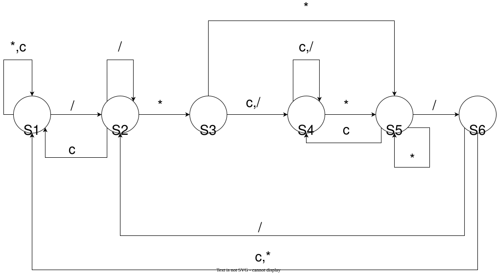

## T1

### 题目描述

有 8 个导体金属节点，编号 $0,1,\dots, 7$。现在用三根导线连接，第 $i$ 根导线连接 $a_i, b_i$ 两个节点。
询问 $u,v$ 两个节点是否导通。

特殊地，每一个金属节点总是和自己导通。

### 模块格式

```verilog
input [2:0] a0,
input [2:0] b0,
input [2:0] a1,
input [2:0] b1,
input [2:0] a2,
input [2:0] b2,
input [2:0] query_u,    // 询问的 u
input [2:0] query_v,    // 询问的 v
output connected
```

### Solution

一上来就是重量级。似乎提示给的标准解法是并查集，这里给出一种利用异或运算性质的做法：

```verilog
module connectivity(
    input [2:0] a0,
    input [2:0] b0,
    input [2:0] a1,
    input [2:0] b1,
    input [2:0] a2,
    input [2:0] b2,
    input [2:0] query_u,    // 询问的 u
    input [2:0] query_v,    // 询问的 v
    output connected
);

wire [7:0] w0, w1, w2, q;

assign w0   = (8'b1 << a0) ^ (8'b1 << b0);
assign w1   = (8'b1 << a1) ^ (8'b1 << b1);
assign w2   = (8'b1 << a2) ^ (8'b1 << b2);
assign q    = (8'b1 << query_u) ^ (8'b1 << query_v);

assign connected = !(
    q &&
    (q^w0) && (q^w1) && (q^w2) &&
    (q^w0^w1) && (q^w0^w2) && (q^w1^w2) &&
    (q^w0^w1^w2)
);

endmodule
```

为什么这样做是正确的？

如果 $u=v$，那么 $q=0$；如果 $u,v$ 通过一个导线连接，例如是导线 $1$，那么 $q=w_1$。这都是显然的。

如果 $u,v$ 通过两个导线连接，也就是有一个中间结点，那么这两个导线对应的 $w$ 值在异或时，中间结点位数的 $1$ 会被异或抵消掉。异或和只会留下 $u,v$ 的两个节点。三个导线也是显然的。

所以说：如果一种方案能联通，那么对应的一项异或和就会为 $0$，所以所有情况求与之后取反即可。

这道题传递闭包和并查集的做法可以看这篇博客：
[Zaciowocky 's Wonderland P1课上测试](http://zaciowocky.github.io/2026/10/19/CO_P1%E8%AF%BE%E4%B8%8A%E6%B5%8B%E8%AF%95/)


--- 

事实上，我们有这样的结论：

对于一个无向图 $G = (V,E)$，把其中每一条边 $(a,b) \in E$ 对应一个二进制向量 $w(a,b) = e_a \oplus e_b$（$e_i$ 是只有第 $i$ 位为 $1$ 的单位向量）

那么有：
$$
    u\leftrightarrow v \iff e_u \oplus e_v \in \mathrm{span}_{\mathbb{F}_2}\{w(a,b) | (a,b) \in E\}
$$

其中 $\mathrm{span}_{\mathbb{F}_2}\{v | v = w(a,b), (a,b) \in E\}$ 是在 $\mathbb{F}_2 = \{0,1\}$ 上张成的线性空间（异或运算是一个线性运算，如果你学过线性基的话应该很熟悉）。

下面给出一个简要的证明：

$\to$： 显然的，如果存在一条路径，那么这条路径上的中间节点度数都为偶数，异或会抵消掉，只留下 $u,v$ 两位

$\leftarrow$：如果说存在一些边，这些边的 $w$ 值异或和等于 $e_u \oplus e_v$，这说明在这些边构成的子图中，度数为奇数的节点只有 $u,v$ 两个。那么 $u,v$ 必然在同一个强连通分量中（因为无向图的一个强连通分量中，所有点的度数之和等于边数的两倍，所以度数为奇数的节点也只能是偶数个）。

## T2

### 题目描述

用左右两个键（用 `left, right` 两个信号表示）控制一个小人左右移动，在每次上升沿，根据 `left`，`right` 和上周期的移动方向、控制信号更新本周期的动作。

具体地：

+ 如果 `left = 0, right = 1`，那么向右走
+ 如果 `left = 1, right = 0`，那么向左走
+ 如果 `left = 0, right = 0`，那么小人不动
+ 如果 `left = 1, right = 1`，这时：
  + 如果上周期 `left = 0, right = 1`，说明左键是后按下的，向左走
  + 如果上周期 `left = 1, right = 0`，说明右键是后按下的，向右走
  + 如果上周期 `left = 1, right = 1`，那么保持上周期的移动方向不变
  + 如果上周期 `left = 0, right = 0`，那么向右走

### 模块格式

```verilog
input clk,
input reset,        // 同步高电平有效复位信号，复位时 move_left 和 move_right 都为 0
input left,
input right,
output move_left,   // 置 1 表示本周期向左走
output move_right   // 置 1 表示本周期向右走
```

### Solution

比较白开水的题。用两个 `reg` 记录上个周期的动作模式，加上条件判断即可。

## T3

### 题目描述

串行输入一个字符串，实时统计字符串中除了 `/*...*/` 注释的字符数，结果对 $256$ 取余。
要求建立 Moore 状态机，输出仅在时钟上升沿更新。

例如：

|`char`|`a`|`/`|`b`|`/`|`*`|`/`|`j`|`l`|`*`|`*`|`d`|`*`|`/`|`/`|`r`|`*`|
| ---- | ---- | ---- | ---- | ---- | ---- | ---- | ---- | ---- | ---- | ---- | ---- | ---- | ---- | ---- | ---- | ---- |
| `count` | 1 | 2 | 3 | 4 | 3 | 3 | 3 | 3 | 3 | 3 | 3 | 3 | 3 | 4 | 5 | 6 |

### 模块格式

```verilog
input clk,
input reset,        // 同步高电平有效复位信号
input [7:0] char,   // 串行输入的字符 ASCII 码
output [7:0] count
```

### Solution

建立这样的状态机（初始状态 $S1$）：



这里用 `c` 表示除了 `/` 和 `*` 的其他字符。

实际上单纯考虑状态机设计的话，$S3,S4$ 可以合并。但是拆开的话这样就可以直接依靠状态来判断计数的逻辑：

+ 如果向 $S1, S2$ 转移，那么计数加一
+ 如果向 $S3$ 转移，那么计数减一（因为将前面的 `/` 算作注释的一部分了）
+ 如果向 $S4,S5,S6$ 转移，那么计数不变

这样我们可以采用分离组合逻辑和时序逻辑的方式减少代码量：

```verilog
reg [7:0] stt, nxt_stt;
reg [7:0] ans, nxt_ans;

always @(*) begin
    case (stt)
        S1: nxt_stt = ...
        S2: nxt_stt = ...
        ...
    endcase

    nxt_ans = ...
end

always @(posedge clk) begin
    if (reset) begin
        ...
    end
    else begin
        stt <= nxt_stt;
        ans <= nxt_ans;
    end
end

assign count = ans;
```