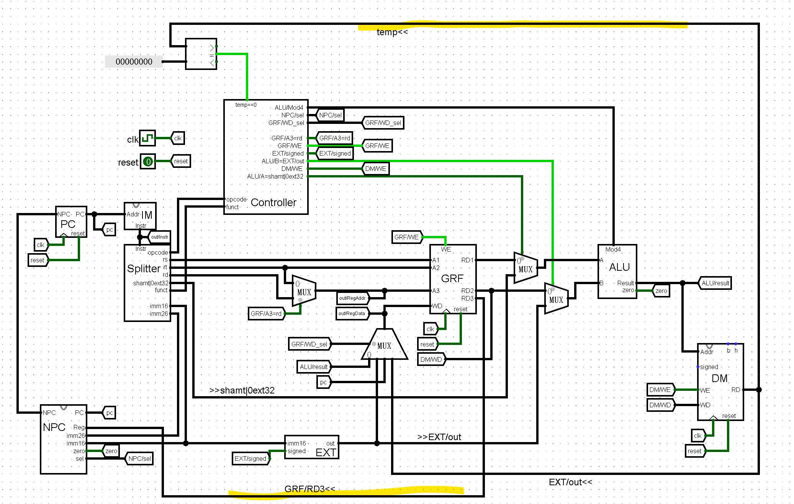

## T1 hamdist

添加指令： `hamdist $rd, $rs, $rt`

R 型指令，令 `$rd` 等于 `$rs` 和 `$rt$` 二进制中不同的位数的个数

实际上就是 `$rs xor $rt` 中 1 的个数。用 bitAdder 就可以解决了

## T2 lwceq（好像叫这个名字）

添加指令：`lwceq $rt, $rs, offset`

RTL:
```RTL
ext_offset <- (sign_extend(offset) <<> 2)_{31...0}
addr <- GPR[rs] + ext_offset
temp <- Mem[addr]_{31...0}
if temp = GPR[rt]
    PC  <- PC + 4 + ext_offset
else
    PC <- PC + 4
```

这个题根据 temp = GRF[rt] 有两种行动方式，但是我们实际可以把它嫁接到 beq 里，这个条件是否成立只需要借用 ALU 的 zero 表示即可。数据通路也比较简单：

符号拓展、左移两位、与 GRF[rs] 相加，这三个过程可以全放到 ALU 里定义一个新运算，就 ok 了。

## T3 lwbr

添加指令：`lwbr $rd, $rs, $rt`

RTL:
```RTL
addr <- GRF[rs] + GRF[rt]
temp <- Mem[addr]
if temp = 0
    PC <- GRF[rd]
else
    GRF[rd] <- temp
```

这个题涉及到了同时读取 GRF 的三个寄存器，所以我们得在 GRF 里再添加一个输出，输出 A3 对应寄存器的值（这时就体现了用 tunnel 的好处，直接把 mux 复制一次就好了）

先画出数据通路：
```
rs -> GRF/RD1 -> ALU/A |   
                       + -> DM/RD -> temp
rt -> GRF/RD2 -> ALU/B |
```

由于 temp 是否等于零会导致后面的行为完全不同，我们可以把计算出的 temp 送回 Controller，让 Controller 根据 temp 的值发送控制信号（也就是说，原先那种控制信号矩阵的模型不够细致了）。

一个示意图：


由于我们没有要求实现，直接把 GRF/RD3 接入 NPC/Reg 就好了