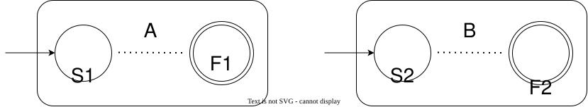
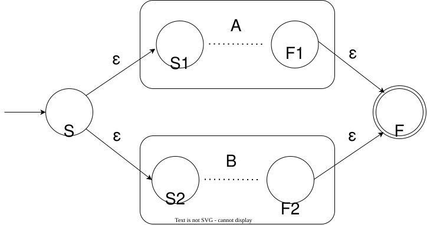
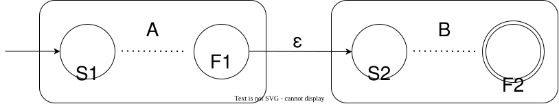
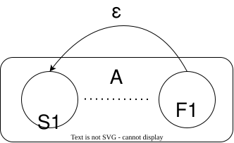
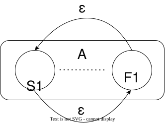
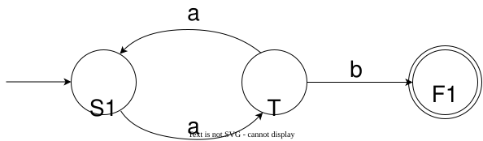
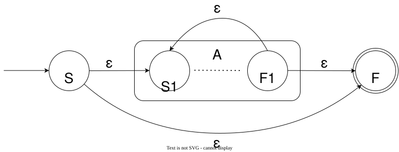
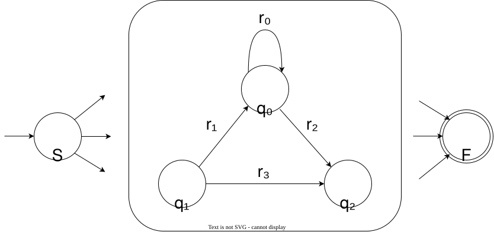
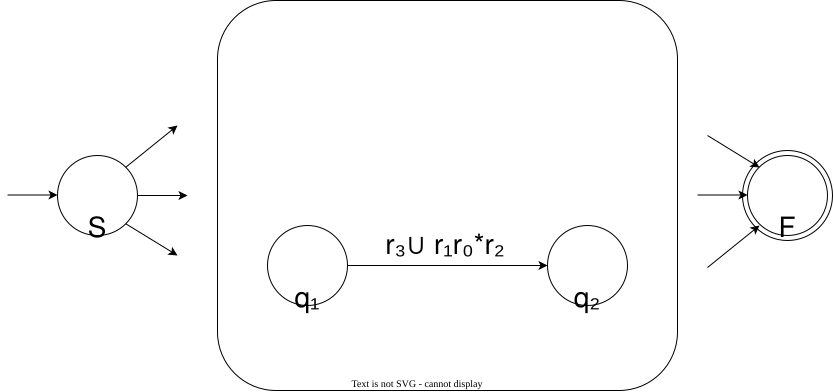

## 正则语言在正则运算下的封闭性

在上一节中我们介绍了 NFA 与 DFA 在表达能力上的等价性。这为我们证明正则语言在三种正则运算：$\cup, \circ, ^*$ 下的封闭性提供了便利。我们只要给出一种构造方式，对于任意的 NFA $A,B$：

+ 构造出 NFA $M_1$，使得 $L(M_1) = L(A) \cup L(B)$
+ 构造出 NFA $M_2$，使得 $L(M_2) = L(A) \circ L(B)$
+ 构造出 NFA $M_3$，使得 $L(M_3) = L(A)^*$

在图示中，我们把 $A,B$ 这两个 NFA 的细节抽象掉，简化成下面的样子：



我们只留下 $A,B$ 的起始状态 $S_1, S_2$ 和接受状态 $F_1, F_2$，它们内部的部分就直接用虚线代替省略。

> 这里我们不妨假设 $A,B$ 都只有一个接受状态，分别是 $F_1,F_2$。且 $F_1, F_2$ 均没有出发的转移边。
>
> 为什么可以这样做呢？
>
> 实际上，对于一个有多个接受状态的 NFA，我们可以添加一个新的状态 $F$，让 $F$ 成为唯一的新的接受状态。而对于原先的每一个接受状态 $D$，都添加一条从 $D$ 到 $F$ 的 $\varepsilon$ 转移边。
> 
> 这样就可以得到一个和原 NFA 等价（两个 NFA 等价意味着它们识别相同的语言）且满足假设的新 NFA。

### 正则语言在并运算下的封闭性

这个结论我们已经给出了一个 DFA 构造，且在上一节中，我们已经构造出了一个 NFA，识别 $L_1 = \{0^{2k}| k \in \mathbb N\}$ 和 $L_2 = \{0^{3k}| k \in \mathbb N\}$ 的并。
这里我们将这种思想一般化：



这个构造中，我们简单地将 $A,B$ 并置在一起，仅需要加入两个新状态，并用 $\varepsilon$ 转移边来表示“或”的含义。进入状态 $S$ 后，NFA 要么选择进入 $A$，要么选择进入 $B$，选择中正确的一方接受之后都会免费走到最终的接受状态 $F$。

### 正则语言在连接运算下的封闭性

有了 NFA 之后，我们可以直接使用我们在第二节提到的思路：



新的 NFA 的起始状态为 $A$ 的起始状态 $S_1$，接受状态为 $B$ 的接受状态 $F_2$。$A,B$ 之间只需要通过一个 $\varepsilon$ 边连接即可。这样 $A$ 的部分会猜测输入字符串“到哪里是 $L(A)$ 的部分”，魔法般地找到 $L(A)$ 和 $L(B)$ 的分界点之后走过 $\varepsilon$ 桥梁来到 $B$。

对于 $L(A) = \{11, 110,1100\}, L(B) = \{\varepsilon,01\}$ 的情况。当输入的字符串是 `1101` 时，能够到达 $F_1$ 的计算路线只有两条，分别读入了前缀 `11` 和 `110`。

由于 $F_1$ 没有出发的转移边，所以所有没有过 $\varepsilon$ 桥梁的计算分支都会死掉。接下来读入前缀 `11`，`110` 的分支将会从 $S_2$ 出发，读入 `110` 的前缀在 $B$ 的部分只能提供一个 `1`，无法走到 $F_2$，所以最终只有读入前缀 `11` 的分支会活下来。

因此，我们证明了正则语言在 $\circ$ 运算下的封闭性。

### 正则语言在星号运算下的封闭性

先让我们回忆一下 $^*$ 运算的定义，$L^*$ 中包含的字符串有：空字符串 $\varepsilon$，$L$ 中的字符串，$s_1s_2$（$s_1,s_2\in L$），$s_1s_2s_3$（$s_1,s_2,s_3\in L$）……

先来看一种简单的想法，既然 $L^*$ 可以看成若干个 $L$ 中的字符串拼接而成，那么在识别 $L$ 的 NFA $A$ 的基础上加一条“重置边”，形成一个循环，这样就可以接受多次循环的字符串：



这样的构造有个问题，如果 $\varepsilon \notin L(A)$ 的话，这种方式构造出的 NFA 会拒绝 $\varepsilon$。



那么直接加一条 $\varepsilon$，像这样，是否可以呢？

答案是否定的。如果 $A$ 中存在任何起始于 $S_1$、终止于 $S_1$ 的回路（回路中至少有一个边不是 $\varepsilon$ ），那么这种构造在走过一个回路之后可以直接通过 $S_1$ 到 $F_1$ 的 $\varepsilon$ 边偷渡过去。

例如对于下面的这个 $A$ :



$A$ 识别的字符串是：若干奇数个 `a` 加上一个 `b` 的字符串，即：
$$
L(A) = \{a^{2k+1}b|k \in \mathbb{N}\}
$$

如果使用这种构造，加了 $S_1$ 到 $F_1$ 的 $\varepsilon$ 免费边，那么显然 `aa` 这种不以 `b` 结尾的字符串就会混入。

为了解决这个问题，我们只需要在外面加一层“保护”即可，像下面这样：



这就是最终的构造。于是我们证明了正则语言在 $^*$ 运算下的封闭性。

## 正则表达式

提到这个名字，可能你会想到技术中常用的这种神秘的文本：

```
/^(https?:\/\/)?([\da-z\.-]+)\.([a-z\.]{2,6})([\/\w \.-]*)*\/?$/
```

这里介绍的不是一般提到的技术上的正则表达式，而是计算理论中一种数学上的表达式。但是它们的共同点都是一种形式化的描述语言的方式。

### 正则表达式的语法

既然它是一种表达式，具有树形结构，那么我们肯定可以归纳定义法去定义：

**定义** **正则表达式**（Regular Expression, RE）由以下法则归纳定义：

1. $a$ 是正则表达式，其中 $a$ 是字母表 $\Sigma$ 中的符号
2. $\varepsilon$ 是正则表达式
3. $\emptyset$ 是正则表达式
4. 如果 $R_1, R_2$ 是正则表达式，那么 $(R_1 \cup R_2)$、$(R_1R_2)$、$(R_1)^*$ 也是正则表达式
5. 只有有限次应用规则 1 ~ 4 构成的公式是正则表达式

如果省略括号的话，默认的优先级是：星号 > 连接 > 并。

举例子：

$R_1 = 0^*10(0\cup\varepsilon)$, $R_2 = R_1\emptyset$ 都是正则表达式

### 正则表达式的语义

在这里，我们要定义如何对一个正则表达式**求值**。算数表达式的值是一个数字，逻辑表达式的值是一个真值，而正则表达式的值是一个语言。那么接下来，我们根据正则表达式定义的方式，给出其对应的语言。

**定义** 如果 $R$ 是一个正则表达式，那么 $L(R)$ 为 $R$ **描述的语言**。

1. 若 $R = a, a\in\Sigma$，那么 $L(R) = \{a\}$
2. 若 $R = \varepsilon$，那么 $L(R) = \{\varepsilon\}$
3. 若 $R = \emptyset$，那么 $L(R) = \emptyset$
4. 若 $R = R_1 \cup R_2$，其中 $R_1,R_2$ 是正则表达式，那么 $L(R) = L(R_1) \cup L(R_2)$
   
   **注意！** 在 $R = R_1 \cup R_2$ 里面的 $\cup$ 是正则表达式的一个运算符号。而 $L(R) = L(R_1) \cup L(R_2)$ 里面的 $\cup$ 是正则运算中的并运算。

5. 若 $R = R_1R_2$，其中 $R_1,R_2$ 是正则表达式，那么 $L(R) = L(R_1) \circ L(R_2)$
6. 若 $R = R_1^*$，其中 $R_1$ 是正则表达式，那么 $L(R) = L(R_1)^*$

例如：

对于正则表达式 $R_1 = 0^*10(0\cup\varepsilon)$，它描述的语言是 $L(R_1) = \{s \in \{0,1\}^*| s \text{ 除了倒数第二个位置或者倒数第三个位置为 } 1, \text{ 其余位置全为 }0\}$，而对于 $R_2 = R_1\emptyset$，它描述的语言是 $L(R_2) = \emptyset$，因为根据连接运算的定义，在后半部分的 $\emptyset$ 上找不出任何字符串。

为了实际使用便捷，我们通常定义下面的缩写：
+ 若 $r$ 是正则表达式，$k$ 是一个**常量**，那么 $r^k$ 表示将 $r$ 重复 $k$ 次，例如 $r^3 = rrr$
+ 若 $r$ 是正则表达式，那么 $r^+$ 表示将 $r$ 重复大于 $0$ 次，即 $r^+ = rr^*$

### 正则表达式和有穷自动机的等价性

正则表达式为什么叫 “正则” 表达式？由上面的定义来看，正则表达式是从几个原子表达式出发，由三种正则运算构建起来的。而正则语言在这三种正则运算下是封闭的。于是你可能有一个大胆的猜想：正则表达式描述的语言是否一定是正则语言？

恭喜你是正确的，但是实际上，我们有一个更强的结论：

一个语言能被正则表达式描述，**当且仅当**它是正则语言。也就是说：
$$
    \exists R, R\text{ 是 } RE, L = L(R) \iff
    \exists N, N\text{ 是 } NFA，L = L(N)
$$

这个结论极其强大，我们将分两个方向进行证明

#### 正则表达式描述的语言都是正则语言

这个结论几乎已经呼之欲出了，我们的证明方式是：给出一种 RE $\to$ NFA  的翻译法。
在这里我们重述一个完整的、编译式的构造方式：Thompson 构造法

> 在这里，我们仍然假设我们给出的 NFA 都符合前面的假设：有且仅有一个接受状态，且这个接受状态没有出发的状态转移边

1. 如果 $R = a, a \in\Sigma$，那么构造的 NFA 为：
   
2. 如果 $R = \varepsilon$，那么构造的 NFA 为:
   
3. 如果 $R = \emptyset$，那么构造的 NFA 为：
   
4. 如果 $R = R_1\cup R_2$，那么构造的 NFA 为：
   
   其中 $A, B$ 分别是根据 $R_1,R_2$ 构造出的 NFA 
5. 如果 $R = R_1R_2$，那么构造的 NFA 为：
   
   其中 $A, B$ 分别是根据 $R_1,R_2$ 构造出的 NFA
6. 如果 $R = R_1^*$，那么构造的 NFA 为：
   
   其中 $A$ 是根据 $R_1$ 构造出的 NFA

#### 正则语言一定能被正则表达式描述

在有这个结论之前，我们用形式的方式去描述一个正则语言，只能通过给出识别它的 DFA / NFA。那么现在我们想要说明 RE 也有足够的功能，那么我们要做的就是：给出一种通用的翻译方式，这种翻译方式能够把一个 NFA $N$ 翻译成 RE $R$，使得 $L(N) = L(R)$。

为了叙述简便，我们将使用一种“增强”的 NFA：广义 NFA（Generalized Nondeterministic Finite Automaton, GNFA），它在 NFA 的基础上，**允许转移边上的标记从单个字符变成一个正则表达式**。例如：


从 $S$ 转移到 $A$，GNFA 可以读入：$\varepsilon$, $a$, $b$, $aa$, $ab$, $bb$, $aaa$, $aab$, $abb$, $bbb$, $aaaa$……;

从 $A$ 转移到 $F$，GNFA 可以读入：$ac$ 或者 $b$。分支之间是非确定性地“并行”关系。

更一般地说，如果一个转移边上的正则表达式是 $R$，它描述的语言是 $L(R)$，那么 GNFA 可以选择 $L(R)$ 中的任意一个字符串作为这一步入读的内容。

由于 NFA 的转移边只能是 $\varepsilon$，或者是 $\Sigma$ 中的字符，这都属于正则表达式。所以每一个 NFA 天生也是一个 GNFA。

显然，GNFA 的计算能力**一定不会弱于** NFA。这里我们选择直接将翻译的起点定为 GNFA。直接给出 GNFA $\to$ RE 的翻译法。

> 这里我们依然进行假设，我们假设处理的 GNFA 均满足：
> 1. 有且仅有一个接受状态 $F$
> 2. 对于任意两个状态 $q_i, q_j$：
>     如果 $q_i = F$ 或 $q_j = S$（起始状态），则不存在从 $q_i$ 到 $q_j$ 的转移边
>     否则，从 $q_i$ 到 $q_j$ 有且仅有一条转移边
>
> 对于 1，我们可以利用在构造识别 $L^*$ 的 NFA 时使用的“套壳”技巧来解决。
> 
> 而对于 2，如果从 $q_1$ 到 $q_2$，同时存在正则表达式为 $R_1$ 和 $R_2$ 的转移边，那么我们可以合并成一个 $R_1 \cup R_2$ 的转移边。
> 而如果从 $q_1$ 到 $q_2$ 没有转移边，那么我们就添加一个 $\emptyset$ 的转移边。

先考虑一个简单的情况，对于一个只有两个状态的 GNFA（也就是只有起始状态 $S$ 和接受状态 $F$），那么根据假设，一定只存在一条边，也就是从 $S$ 到 $F$ 的转移边。那么最终的正则表达式就是这条边上的正则表达式。

如果状态数大于 $2$，也就是这个 GNFA 除了 $S,F$ 还有其他的状态，该怎么办呢？
我们的方法是：我们一个一个地删掉 GNFA 的状态，并在这个过程中更改边上的正则表达式，维持 GNFA 识别的语言不变。

具体地，例如我们在下面的 GNFA 中挑了一个状态 $q_0$，准备删除（$r_0, r_1, r_2, r_3$ 都是正则表达式）：



这个图中，我们进行了适当的省略，只保留了一个指向 $q_0$ 的转移边和它的源状态 $q_1$、一个从 $q_0$ 出发的转移边以及它的终点状态 $q_2$，从 $q_1$ 指向 $q_2$ 的转移边以及 $q_0$ 的自环边。

如果删除 $q_0$，那么从 $q_1$ 到 $q_2$ 的转移边就必须换成：
$$
r_3 \cup r_1r_0^*r_2
$$

因为原先从 $q_1$ 到 $q_2$ 可以先到 $q_0$，在自环中走若干次，然后再走到 $q_2$，这整个过程就表示了 $r_1r_0^*r_2$，再并上原来的 $r_3$，就变成了 $r_3\cup r_1r_0^*r_2$。



图中我们进行了省略，实际上，我们要对 $q_0$ 的每一个输入、输出边对都进行上述的操作。

于是，这样我们就可以逐步削减 GNFA 的状态数，直到只剩两个状态时，从 $S$ 到 $F$ 的转移边上的正则表达式就是最终的翻译结果。

## 到目前为止的总结

在截止到这里的部分，我们主要介绍了两种计算模型：**DFA** 和 **NFA**，以及一种描述语言的表达式：**正则表达式**。

而它们的表达能力完全相同，范围都是**正则语言**，也就是说：

如果语言 $A$ 是正则语言，那么：
+ 一定存在 DFA $M$，使得 $A = L(M)$
+ 一定存在 NFA $N$，使得 $A = L(N)$
+ 一定存在正则表达式 $R$，使得 $A = L(R)$

反之，如果语言 $A$ 不是正则语言，那么：
+ 任何一个 DFA $M$，都有 $A \neq L(M)$
+ 任何一个 NFA $N$，都有 $A \neq L(N)$
+ 任何一个 RE $R$，都有 $A \neq L(R)$

DFA，NFA 和正则表达式的表达能力相同，它们可以互相翻译：

+ DFA $\to$ NFA：DFA 天生就是 NFA
+ NFA $\to$ DFA：使用子集构造法
+ NFA $\to$ RE：先转换为符合假设的 GNFA，再逐个删除状态
+ RE $\to$ NFA：使用 Thompson 构造法

接下来，我们将研究一个正则语言，它本身作为字符串的集合，有哪些特殊性质。这部分的内容详见下一节：